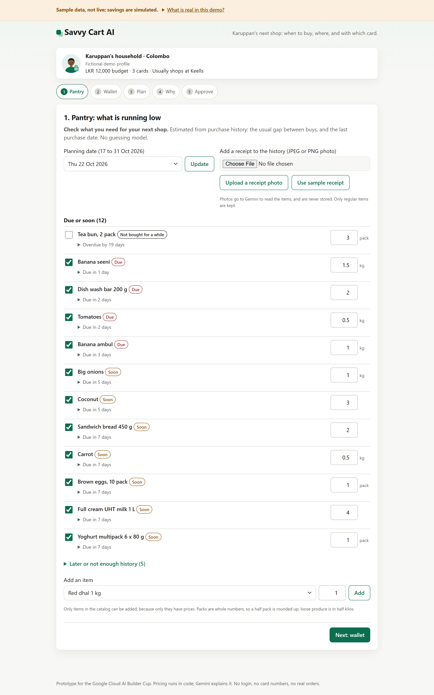
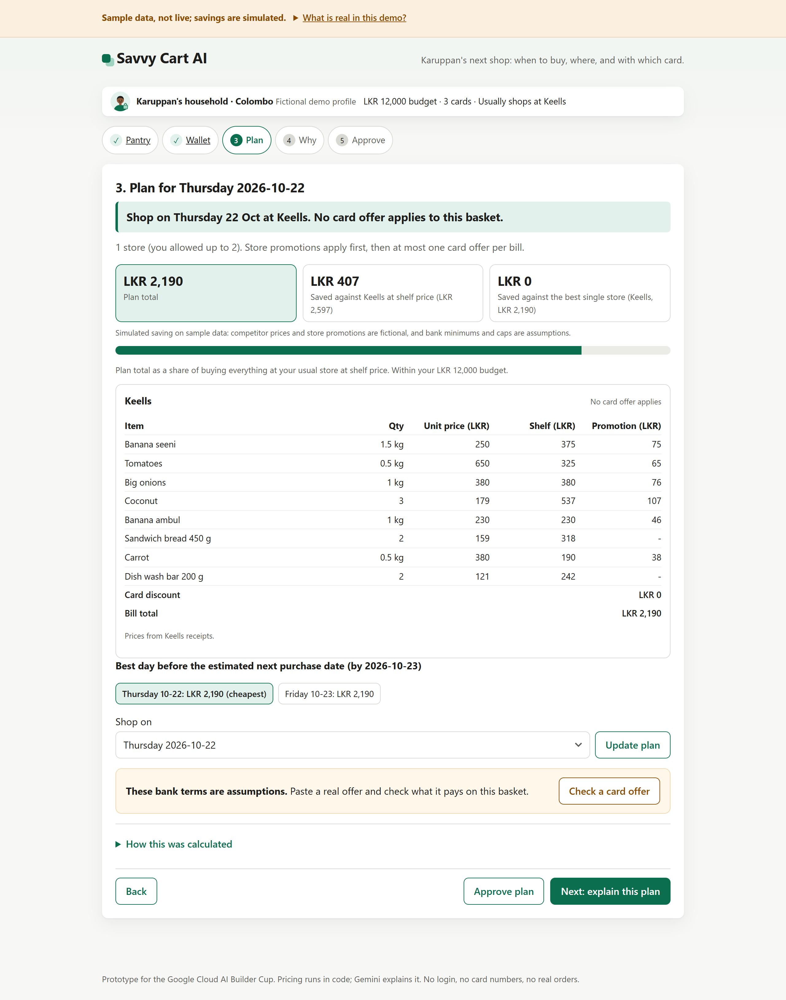
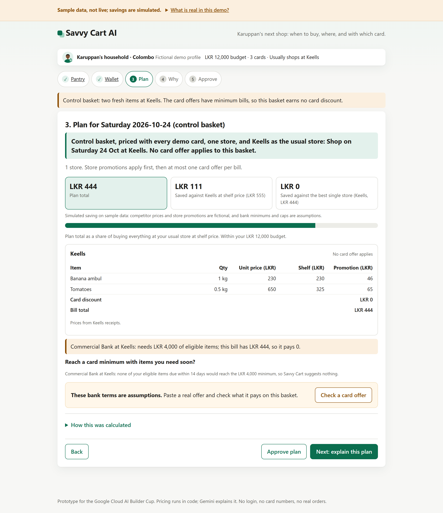
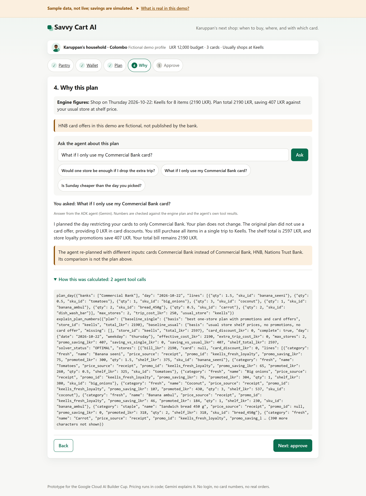
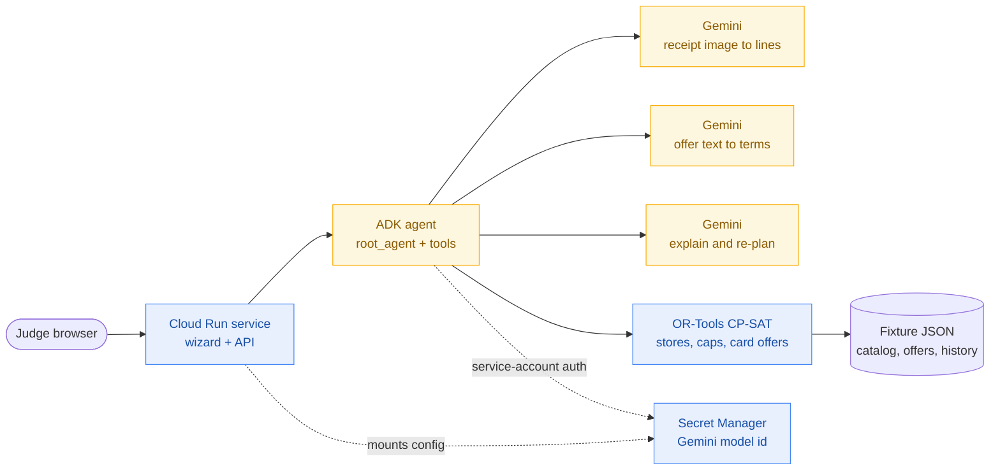

# Savvy Cart AI

**A condition-aware grocery basket optimizer for Sri Lankan households — built on Google Cloud with Gemini and the Agent Development Kit.** It reads your receipts, works out what you are running low on, and plans the cheapest *legal* way to buy it on a chosen day: up to four stores, one card per bill, every exclusion, minimum, cap, and card rule applied in code — not guessed by a model. Then the shopper decides.

**[▶ Live demo](https://savvy-cart-890425261137.asia-southeast1.run.app)** · [Pitch deck (PDF)](docs/submission/Savvy-Cart-AI-gTaprobane-Pitch-Deck.pdf) · Built for the [Google Cloud AI Builder Cup 2026](https://aibuildercup.com/), Retail & Commerce theme.

<!-- Demo video (≤3 min): add the YouTube / Vimeo / public Drive link here before submitting, e.g. [▶ Demo video](https://youtu.be/...) -->

> **The trap is the headline.** A bank SMS says "10% off on Total Bill every Saturday" — but the terms behind it exclude rice, milk powder, and dhal, need an LKR 8,000 bill, stop at LKR 1,000, and cannot be combined with the store's own promotions. **Offer Reality Check** lets the shopper paste such an offer: Gemini reads the terms, the shopper confirms them, and the engine shows what the headline promises against what the terms actually pay on *this* household's basket.

## Try it now — judges, no login, about three minutes

Open the live URL: **https://savvy-cart-890425261137.asia-southeast1.run.app** (Cloud Run, asia-southeast1). The first load can take tens of seconds while Cloud Run starts an instance from zero — please wait rather than refreshing.

- It is a five-step wizard: **Pantry → Wallet → Plan → Why → Approve**, with Back and Next on every step.
- On the **Why** step, ask the sample question: **Why isn’t rice discounted?**
- On the **Wallet** step, press **Show a basket this offer refuses** to watch the engine say, in amber, that an offer pays nothing.
- Every screen carries the banner **Sample catalog — not live shelf prices.** Press **What is real in this demo?** for the full breakdown.

The full, step-by-step judge path is [below](#judge-path-in-detail).

## A look at it

<table>
<tr>
<td width="50%"><br><sub><b>Pantry</b> — what you are running low on, from receipt history. No model guesses the dates.</sub></td>
<td width="50%"><br><sub><b>Plan</b> — each bill line by line, the saving against shelf price, and the best day to shop.</sub></td>
</tr>
<tr>
<td width="50%"><br><sub><b>Honest math</b> — when a card offer's minimum is not met, the engine says it pays LKR 0.</sub></td>
<td width="50%"><br><sub><b>Why</b> — the ADK agent answers in words and shows every tool call it made.</sub></td>
</tr>
</table>

## The problem

A Colombo household holds three credit cards and shops at four supermarket chains. Every chain runs item promotions; every bank runs card offers tied to one store, one weekday, a category, a minimum bill, and a cap. Three everyday questions have no easy answer:

- **When will the staples run out?**
- **Which store and which card, for which items?**
- **What does a promotion really save?** The headline is a trap: a "10% off every Saturday" can exclude rice, milk powder, and dhal, need an LKR 8,000 bill, cap at LKR 1,000, and refuse to combine with the store's own promotion — so it may pay nothing at all.

No shopper can hold that matrix in their head, and a headline percent overstates the saving.

## How the architecture solves it

Savvy Cart splits the work so the generative model does what only a model can, and deterministic code owns every number a shopper would act on:

| The shopper's problem | How Savvy Cart solves it | Built with |
| --- | --- | --- |
| Receipts and offers are unstructured images and prose | Gemini reads a receipt photo into catalog-matched lines, and bank-offer text or a screenshot into a fixed terms schema | **Gemini** (multimodal) on Agent Platform |
| "When will the staples run out?" | A pantry from real receipt history: the median gap between purchases gives each item a due date | Deterministic `pantry.py` |
| "Which store and card, for which items?" | An exact optimizer assigns items across up to four stores, applies the best store promotion per line, and picks at most one card offer per bill, net of the cost of an extra trip | **Google OR-Tools** (CP-SAT) |
| "Does this headline actually pay?" | Offer Reality Check applies the exclusions, minimum, and cap to this basket and shows the headline against what the terms really pay — often LKR 0 | Deterministic `offercheck.py` |
| "Can I trust an AI with my money?" | The model never sources a number; two grounding layers drop any figure the engine did not produce | **ADK** callbacks + output re-check |
| "I just want to try it — no account" | A guest URL, a five-step wizard, and a MOCK approval that sends no order | **Cloud Run** |

**The model is never the source of a price, a discount, a due date, or a total.** Recorded live latencies, the receipt-text-is-data guardrail, and commands to reproduce each model call are in **[docs/GENAI_EVIDENCE.md](docs/GENAI_EVIDENCE.md)**.

## Architecture on Google Cloud



### Cloud Run — the judge-facing service

- Region `asia-southeast1`; the FastAPI app (`src/savvycart/http.py`) served by uvicorn, source-built from the repo `Dockerfile` (`python:3.12-slim`, non-root user, port 8080).
- **Scales to zero:** `--min-instances=0`, `--max-instances=3` (the cap bounds per-instance Gemini cost on a public URL), request `--timeout=120`.
- **Guest access:** `--allow-unauthenticated`, no login. First load after idle takes tens of seconds while an instance starts.

### Gemini — `gemini-3.8-flash` on the Gemini Enterprise Agent Platform

| Gemini job | Input → output | How it stays grounded |
| --- | --- | --- |
| **Receipt extraction** | receipt photo → catalog SKU, decimal quantity, and a confidence per line | lines below 0.6 confidence stay unchecked; the image is never stored |
| **Offer reading** | bank offer text or a screenshot → a fixed terms schema (rate, days, minimum, cap, exclusions, combining rules) | code validates every field; the shopper confirms before it counts |
| **Explain** | the optimizer's JSON → a plain-language answer | the answer may quote only numbers the engine produced |
| **Re-plan** | the shopper's question → a fresh `plan_day` call with new inputs | the page states plainly when it re-planned with different inputs |

Measured live on 18 Oct 2026: the Why answer ≈ 15-50 s, offer reading ≈ 5-7 s.

### Agent Development Kit — one agent, six tools

`root_agent` exposes **`get_pantry`, `load_catalog`, `load_offers`, `plan_day`, `explain_plan_numbers`, and `check_card_offer`**, plus two guardrail callbacks that keep it inside the planning window and strip any ungrounded number. The Why step shows every tool call with its arguments.

### OR-Tools (CP-SAT) — the money math

An exact constraint solver assigns each item across up to four stores, applies the store promotion that saves most per line, and picks at most one card offer per bill, net of the cost of an extra trip. Runs in-process; the model never computes a rupee.

### Secret Manager — configuration, not credentials

Holds the `GEMINI_MODEL` id as deploy-time configuration. **No API key or credential is stored anywhere** — the runtime authenticates to Gemini with the Cloud Run service account's Application Default Credentials (ADC). Nothing secret is in this repo.

**Google Cloud usage, in one paragraph (for the submission description):** The judge-facing app is a FastAPI service deployed on **Cloud Run** in `asia-southeast1` with minimum instances 0. Generative AI is **Gemini (`gemini-3.8-flash`) on the Gemini Enterprise Agent Platform**, orchestrated by a single **Agent Development Kit** agent that exposes planner tools and enforces grounding through ADK callbacks. The model configuration is held in **Secret Manager** and mounted at deploy; the runtime authenticates with the Cloud Run service account's Application Default Credentials, so no API key is stored anywhere. Receipt images are processed in memory and never written to disk, storage, or logs, and extraction is rate limited. Deploy steps are in [docs/deploy.md](docs/deploy.md).

## Tech stack

| Layer | Choice |
| --- | --- |
| Language | Python 3.12 (3.11+) |
| Web & API | FastAPI, served by uvicorn |
| Frontend | Server-rendered HTML with a small vanilla JS/CSS layer — no framework |
| Generative AI | Gemini (`gemini-3.8-flash`) via `google-genai`, orchestrated with the Agent Development Kit (`google-adk` 2.x) |
| Optimization | Google OR-Tools (CP-SAT), `ortools` 9.x |
| HTTP client | `httpx` |
| Tests | `pytest` — 120 passing |
| Container & deploy | Docker (`python:3.12-slim`, non-root) → Cloud Run |
| Google Cloud | Cloud Run, Gemini on Agent Platform, Secret Manager |

## What's real in this demo

The evidence is one real shopper's 26 Keells e-bills (5 May to 17 Oct 2026, de-identified): promotions were item-level, not bill-wide, and on four days the shopper paid at more than one store. The demo pantry adds 17 fictional Cargills and Glomark bills, labeled on every page. Every saving the app shows is simulated on sample data.

**Sample catalog — not live shelf prices.** Keells prices come from that shopper's real receipts. Cargills, SPAR, and Glomark prices stay within 10% of Keells and are fictional. Nations Trust Bank and Commercial Bank card offers are their published supermarket headlines, captured from the banks' promotion pages on 18 Oct 2026; their minimum bills and caps are not published there, so those are labeled assumptions. HNB offers and every store promotion are fictional demo shapes.

## Judge path in detail

A card for Karuppan's household (a fictional demo profile) sits above the steps and shows the current budget, cards, and usual store. The sample-data banner stays on every step; press **What is real in this demo?** for what is real and what is fictional.

1. **Pantry.** **Planning date** is set to Thursday 22 Oct 2026; it offers 17 to 31 Oct because the sample history ends on 17 Oct, and only purchases up to that date count. From the usual gap between purchases and the last purchase date, the pantry lists 12 items as due or soon, each with a short label such as "Due in 3 days"; open the label for the reason, for example "Bought on 17 days, about every 8 days. Last bought 17 Oct, so due 25 Oct (in 3 days)." No model guesses this. Quantities respect how an item is sold: packs and cartons are whole numbers (a 2-pack of buns is never 2.5), and produce priced by weight is planned in half kilos (carrots 0.5 kg). Tea bun is overdue by more than its own cycle, so it is marked "Not bought for a while" and starts unchecked. **Add an item** puts any other catalog item in the basket.
2. Press **Use sample receipt** to add a redacted Keells receipt to the history, dated on the planning day. The page lists the lines it added, and the list drops from 12 to 9: eggs, milk, and yoghurt were just bought. **Upload a receipt photo** sends your own JPEG or PNG to Gemini when a model is configured; Gemini matches each line to the catalog, so receipts from any of the four chains work, and loose produce keeps its weight in the history (0.375 kg stays 0.375, while the pantry plans the next buy in half kilos). A line that matches no known item description and that Gemini is less than 60% sure of is left out. The photo is never stored.
3. **Wallet.** Karuppan holds Commercial Bank, Nations Trust Bank, and HNB credit cards, shown as issuer and product only. Choose the cards, the usual store, up to four stores in one day, and the cost of an extra trip (LKR 250 by default, labeled an assumption).
   - **Check a card offer.** Press **Use the sample offer**: Seylan Bank's published Keells terms, checked on seylan.lk on 18 Oct 2026. The headline suggests LKR 593 off this basket; the terms pay **LKR 0** (shown in amber), because the bill is LKR 2,475 short of the LKR 8,000 minimum, and six items on a store promotion would not count anyway. The page lists every line with the reason it counts or not, notes that the terms also exclude the milk powder and dhal this household buys, and shows the engine's best plan if Karuppan held that card. **Read it with Gemini** reads pasted text or a screenshot into a fixed schema; code validates every field and never invents a minimum, cap, or percent; the shopper can correct the terms and recheck. Savvy Cart is not affiliated with Seylan Bank.
4. **Plan.** Press **Next: plan my shopping**. An exact optimizer (Google OR-Tools CP-SAT) assigns every checked item to a store, applies the store promotion that saves most on each line (a percent off, or a fixed price for up to a number of units), then picks at most one card offer per bill. On the default inputs the page opens with its recommendation, "Shop on Friday 23 Oct at Keells and Cargills. Pay with Commercial Bank credit at Cargills." (its published "up to 25%" Friday offer): LKR 4,604 including the extra trip, which is LKR 1,328 less than buying everything at Keells at shelf price. The page shows each bill line by line with quantities and unit prices, the offer's published headline and source when it is a real bank offer, both baselines (the two-store split beats the best single store by only LKR 63, and raising the trip cost to LKR 320 makes the engine drop the second store), and the best day to shop before the estimated next purchase date. When a card offer misses its minimum, the page may suggest up to three items you need within 14 days that would reach it, with the engine's re-planned total; it never adds them, and says so when nothing you need would reach it.
5. On the Wallet step, press **Show a basket this offer refuses**. A small Saturday basket at Keells misses the Commercial Bank minimum, the card discount is LKR 0, and the page says how far the offer was from paying.
6. **Why.** Press **Next: explain this plan**. The one ADK agent explains the plan and may re-plan, for example to compare another day or a smaller wallet. Ask your own question, or press a sample one such as "What if I only use my Commercial Bank card?"; the agent turns it into planner calls, and it can call `check_card_offer` to price an offer you describe against your basket. Its pantry tool sees receipts added in this session. Open **How this was calculated** to see every tool it called with its arguments; the page says plainly, outside that block, when it re-planned with different inputs, and that HNB offers are fictional. Grounding runs in two layers: ADK callbacks inside the agent keep it within the planning window and strip ungrounded numbers, and the page re-checks on the way out. Any number in the answer that no engine output produced is dropped before it is shown, and so is a sentence that calls the plan total a saving or the saving a total. If no model is configured, the agent call fails, or the service has reached its limit of 20 explanations a minute, the page says so and shows the engine's own explanation.
7. **Approve.** Choose Pickup or Delivery (MOCK). Delivery adds an assumed fee per store bill (LKR 350, editable) and says that no booking is made and Savvy Cart is not integrated with Uber, PickMe, or any store. The page shows a MOCK order preview. No order is sent.

Mock partner endpoints, `GET /mock/stores`, `GET /mock/stores/{store_id}/catalog`, `GET /mock/banks`, and `GET /mock/banks/{bank_id}/offers`, serve the same labeled data the engine reads, the way store and bank APIs would.

## The original single-store API

The first slice, a single-store offer checker, still runs unchanged at `POST /v1/plans`, `POST /v1/explain`, `POST /v1/receipts`, and `POST /v1/approve`. Its sample shopper is **Karuppan, Saturday, Commercial Bank credit, budget about LKR 12,000.** It answers one question the guided flow builds on:

- **Why isn’t rice discounted?** Rice is a staple. That card offer covers fresh items only, so rice stays at shelf price in every plan.

## Cannot do

This prototype does not provide:

- live prices or live stock from any retailer
- real orders, payments, or partner checkout (approve is a MOCK preview)
- card numbers: it never asks for, stores, or logs a card number, only an issuer and product
- bank affiliation: two banks' published offer headlines are shown with their source and assumed terms, HNB offers are fictional, and Savvy Cart AI is not affiliated with or endorsed by Commercial Bank, Nations Trust Bank, HNB, or any retailer
- delivery or partner integrations: the delivery option and the partner endpoints are mocks
- forecasting beyond the purchase gaps: due dates come from the median gap between purchases, not a trained model

## Run it locally

```bash
pip install -e ".[dev]"
python -m pytest -q
uvicorn savvycart.http:app --reload
```

Open http://127.0.0.1:8000/. Without a configured model the whole flow works: **Upload a receipt photo** says the live extract is unavailable, and **Next: explain this plan** shows the engine explanation.

`samples/purchase-history.json` is built from the shopper's e-bill PDFs by `scripts/build_history.py`. The PDFs stay on the shopper's machine and are never committed. Only dates, chains, line items, amounts, and promotions are kept.

## How this was built

Spec-driven, with the [Agentic Development Lifecycle](https://www.agenticlifecycle.ai/) (ADLC): an approved spec, small tickets with verifiable acceptance criteria, frozen rails, and a hostile review before each slice is accepted. See [`AGENTS.md`](AGENTS.md) and [`docs/adlc/WORKFLOW.md`](docs/adlc/WORKFLOW.md).

## Team

**gTaprobane**

- Yogendran Nadaraja — yogendrann@gmail.com
- Tharindu N. Madhusankha — tharindu.red@gmail.com

## License

This project is **proprietary**. The source is published here for Google Cloud AI Builder Cup 2026 evaluation only; it is not open source and no rights are granted beyond review. See [`LICENSE`](LICENSE).
