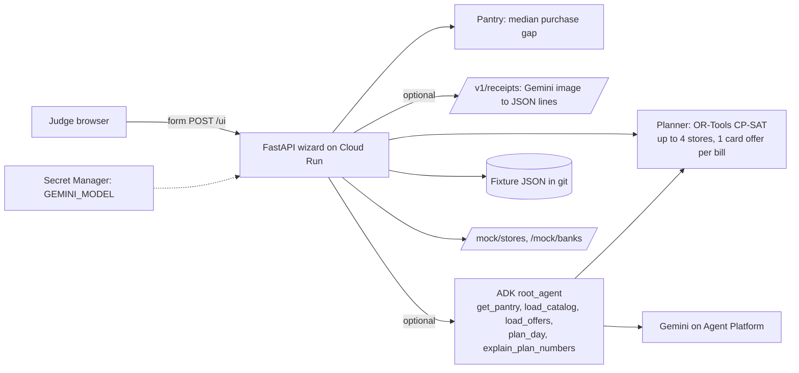

# Savvy Cart AI — AI Builder Cup 2026 readiness review

> Reviewer: Claude (Opus 5.5) · Date: **18 Oct 2026, deadline day** · Revision reviewed: `1d1b73b` (main, clean)
> Scope: business problem, product strategy, architecture, every file under `src/`, fixtures, tests, deploy docs, ADLC records, and the two earlier reports in this folder.
> Labels: **Verified** = I ran it or read it in the code. **Estimate** = my judgement, not a judge outcome.
>
> **Update, later on 18 Oct:** §11 adds the strategy for making Gemini necessary and giving the problem a "wow" moment. §12 records what was then built (SC-023, v2.2), how it was validated, the revised score estimate, and the database question. §13 records a second pass: an agent `check_card_offer` tool, the guardrails moved into ADK callbacks, and the fractional-pack fix. Sections 1–10 describe revision `1d1b73b`, before those changes.

---

## 1. Verdict

**The business problem is a good one and the engineering is above hackathon average. As of this revision, though, the project cannot be scored, because the mandatory submission items do not exist yet.**

- **Problem:** Strong and specific. The question is: given what this household needs, the cards it holds, the store promotions, offer minimums and caps, and the cost of an extra trip, what is the cheapest way to shop this week? It is local, easy to understand, and backed by a real shopper's receipts. It fits the Retail & Commerce theme well.
- **Architecture:** Sound and easy to defend. Gemini reads receipts and explains plans. An exact OR-Tools CP-SAT optimizer computes every rupee. One ADK agent can re-plan through tools, and a number filter stops it inventing figures. All of it runs on Cloud Run. This is the right shape for a 40%-weighted "Technical Merit & GenAI" score.
- **Weaknesses that judges will see:**
  1. **Gemini is peripheral.** The whole flow works without a model, and Gemini has never been run live against this code (the ADLC record says `live_gemini: not-run-no-credentials`).
  2. **The headline saving is made of assumptions.** All LKR 1,331 comes from fictional prices, fictional promotions, and a whole-bill reading of a bank's "up to 25%" headline. The two-store plan beats the best single store by only **LKR 65**.
  3. **The team's own core idea has been diluted.** The original wedge was that a "25% off" does not cover rice or milk powder. In the v2 wizard, every real bank offer now applies to the whole bill with no exclusions, so the wizard no longer shows that idea.
- **Blockers today (Verified):** no deployed Cloud Run URL, the GitHub repo returns **404** to anonymous visitors, there is no deck or video, and the submission ticket SC-013 is still **PARKED**.

**Estimated outcome.** If it is deployed today with live Gemini working, the composite is around **64/100**. With the small changes in §8, it is around **70/100**. That is a credible, competitive entry. It is not yet a likely top-5 finalist, which in my estimate needs roughly 80 or more: stronger, visible GenAI and some measured household evidence. Without a live URL, the score is effectively **0**, because the rules say a dead or missing deploy cannot be judged.

---

## 2. What I checked

| Check | Result |
| --- | --- |
| `python -m pytest -q` | **63 passed** (3.7 s) |
| `scripts/check_judge_readme.py`, `scripts/check_deploy_docs.py` | both **ok** |
| `GET /` through the FastAPI test client | 200, wizard renders |
| Default plan, recomputed from the engine | Friday 23 Oct, Keells + Cargills, **LKR 4,609**, saving **LKR 1,331** vs Keells shelf price. This matches the README. |
| Deployed URL anywhere in the repo | **None.** Only the strategy report mentions `*.run.app`. |
| `https://github.com/nyogendran/savvy-cart-ai` anonymously | **HTTP 404** (private or missing) |
| Live Gemini evidence in `.adlc/manifest.jsonl` | `live_gemini: "not-run-no-credentials"` (SC-010) |
| Docker build evidence | `docker_build: "not-run-daemon-down"` (SC-009) |
| Submission ticket SC-013 (deck, portal text, judge URL, live checks) | **PARKED** |

The earlier Codex report (`report-codex-gpt-6.1-sol.md`) was written against this same revision: it also counted 63 tests and nothing has been committed since. Its code findings are still open. I re-checked each one in §6.

---

## 3. Fit with the competition rules

Rules come from `specs/000-hackathon-context/context.md`, which cites aibuildercup.com, the FAQ, and the Ask-the-Expert session.

| Hard rule | Status | Evidence |
| --- | --- | --- |
| Gemini / Gemma or agent platform | ✅ in code, ⚠️ unproven live | `gemini.py` (google-genai, JSON schema), `agent.py` (ADK `Agent` with five tools) |
| Judge-facing deploy on Cloud Run or Firebase | ❌ **not deployed** | `Dockerfile` and `docs/deploy.md` are ready; no URL exists |
| Working end-to-end prototype | ✅ locally | 63 tests; the wizard completes through the mock approval |
| English materials | ✅ | |
| No secrets in repo, deck, or video | ✅ repo looks clean | Keyless Agent Platform auth; model id in Secret Manager; `.gitleaks.toml` present. Gitleaks was not re-run in this review. |
| Synthetic data clearly labeled | ✅ mostly | A banner on every step. One gap: the fictional history bills are not named in the banner (§5.3). |
| Pitch deck (PDF) | ❌ missing | SC-013 parked |
| Demo video under 3 minutes | ❌ missing | SC-013 parked |
| Public GitHub | ❌ **404** | Must be public, or at least reachable by judges |
| Description of Google Cloud usage | ❌ missing | Can be written from the README's "How it works on Google Cloud" table |
| URL alive 19 Oct – 6 Nov | n/a until deployed | `--min-instances=0` is the right call. Add `--max-instances` (§8). |

**Theme fit: strong.** Retail & Commerce asks for "intelligent customer experiences": personalization and conversational shopping. Savvy Cart is personal in a concrete way (this household's history, these cards, this day) and has a visible agent. Keeping BFSI as a later adjacency is the right decision.

---

## 4. Scoring against the rubric (estimates)

| Criterion | Weight | Deployed as is | After the §8 changes | Why |
| --- | ---: | ---: | ---: | --- |
| Technical Merit & GenAI | 40% | 68 | 74 | An exact CP-SAT optimizer with per-bill card minimums and caps, a real ADK tool loop with a visible tool trace, a grounding filter, and 63 tests are well above typical entries. They lose points because Gemini is optional and only explains or reads text, and because judges cannot see a live model run unless the video shows one. |
| Problem Alignment & Impact | 25% | 62 | 68 | A real local pain with real receipts. Every rupee of impact is simulated, the evidence is one household, and the multi-store benefit on the demo basket is LKR 65. |
| Innovation & Creativity | 25% | 58 | 64 | A pantry built from receipt history, an optimizer that knows offer conditions, trip costs, "this offer refuses your basket", and suggestions to reach an offer minimum make a distinctive combination. But Ithuru already markets "best day, store and card", and v2 dropped the line-level exclusion story that set this project apart. |
| UX & Solution Design | 10% | 70 | 72 | A clean five-step guest wizard, no login, honest labels, Back and Next on every step, a mock order preview. It is form-heavy and server-rendered, and the free-form conversation part is not visible. |
| **Composite** | | **≈ 64** | **≈ 70** | |

For comparison, the team's own strategy report (§1.2) predicted 70 if the narrow slice shipped cleanly. The build has gone past that slice (multiple stores, a pantry, a wizard), but the two things that would lift the score, live AI evidence and verified terms, are still missing.

---

## 5. Business problem: assessment

### 5.1 What is strong

- **A real, checkable local pain.** Sri Lankan bank card offers are tied to a store, a weekday, a category, a minimum, and a cap. CardHub counts 58 supermarket offers across 11 banks (strategy report §5). No shopper can work that out in their head.
- **Real evidence.** One shopper's 26 de-identified Keells e-bills (5 May – 17 Oct 2026). The README's observation that promotions were item-level and that the shopper paid at more than one store on 4 days is a genuine insight, not a made-up persona.
- **An honest product stance.** "The model is never the source of a price", a refused-offer demo, a mock order preview, and no card numbers. Judges, and especially the Google speaker the team quotes, reward naming what the product cannot do.
- **A clear local-to-global story.** Fragmented grocers plus day-and-category card offers are a pattern across Asia-Pacific. The story does not depend on one retail chain.

### 5.2 What weakens it: where the LKR 1,331 comes from (Verified)

I recomputed the default plan from the engine:

| Component | LKR | Data status |
| --- | ---: | --- |
| Keells shelf total for the 11 checked items (baseline) | 5,940 | Real Keells receipt prices |
| Cheaper shelf prices at Cargills | −45 | **Fictional** (within ±10% of Keells) |
| Store promotions | −565 | **Fictional** demo shapes |
| Commercial Bank card discount at Cargills on Friday | −971 | **Published headline "up to 25%"**, read as a flat 25% of the whole bill. The minimum and cap are **assumed**. |
| Extra-trip cost | +250 | Labeled assumption |
| **Plan total** | **4,609** | |
| Best single-store plan (Cargills alone, with the same card) | 4,674 | |
| **Benefit of the two-store split** | **65** | |
| Plan with no cards in the wallet | 5,524 | Only 416 saved, all of it from fictional data |

What this means:

1. **Every rupee of the headline saving depends on fictional or assumed inputs.** That is allowed if labeled, and the README does label the inputs. But the video and deck must not present 1,331 as a measured saving. Call it a **simulated saving on sample data**.
2. **73% of the saving (971 of 1,331) rests on reading "up to 25%" as exactly 25% on every item.** "Up to" usually means the rate varies by category or is capped per item. A judge who knows retail will notice.
3. **The multi-store result is weak.** Paying LKR 250 for a second trip to save LKR 315 nets only LKR 65. This can be turned into a strength: "the optimizer tells you when a second trip is not worth it". Raise the trip cost to LKR 320 on camera and the plan falls back to one store. That is a strong demo moment. As things stand, the headline result looks like a two-store win when it is really a one-card win.

### 5.3 Evidence gaps to fix in how the project is presented

- **The pantry is mostly driven by the fictional bills.** Using only the 26 real bills, the pantry on 22 Oct lists **2** items as due or soon. With the 17 fictional Cargills and Glomark bills added, it lists **12**. The README says "the evidence is one real shopper's 26 Keells e-bills" and does not mention the 17 fictional bills. Add one sentence, for example: "Pantry history is 26 real Keells bills plus 17 fictional Cargills/Glomark bills, labeled."
- **"Before items run out"** (plan screen heading) overstates what a median purchase gap can tell you. "Before the estimated next purchase date" is accurate.
- **The README's sample question no longer works in the wizard.** "Why isn't rice discounted?" describes the v1 single-store API, where the Commercial Bank offer covers fresh items only. In the v2 wizard, every published bank offer has `include_categories: []` (assumption C2), so rice **is** discounted on a card bill. A judge who asks the agent this question in the wizard gets an answer that contradicts the README.
- **The v2 offers contradict the team's own research.** The strategy report (§5) records the Commercial Bank Keells offer as "Saturday **fresh-category** 25% with minimum Rs 4,000 and maximum Rs 1,250". `fixtures/v2/offers.json` uses that same minimum and cap but drops the fresh-only restriction. The Seylan and People's Bank terms the team captured both list exclusions: rice, sugar, flour, milk powder, dhal. The project's strongest idea, that a headline percent does not apply to staples, is now absent from the main flow.

### 5.4 Competitors and commercial viability (brief)

- **Ithuru** markets almost the same promise ("best day, store and card") but is still a waitlist. **PriceLens** and **GroceryLK** compare shelf prices with no card logic. Savvy Cart's edge should be stated as **transparent, rule-checked calculations from your own receipts**, not "we compare stores".
- **Who pays** and **where the data comes from** are not addressed: there are no retailer or bank APIs and no willingness-to-pay evidence. This is acceptable for a prototype. The deck should name it as the next step: bank or retailer data partnership, then a pilot with about 8 households comparing the plan to the actual till receipt, as the strategy report's §8.3 proposes.

---

## 6. Solution and architecture: assessment

### 6.1 As built



### 6.2 Strengths (Verified in code)

- **The optimizer is genuinely good.** `planner.py` is an exact model, not a heuristic. Every line goes to exactly one store, at most N stores are used, at most one card offer per bill, the offer minimum is checked against promoted prices, the discount is limited by the cap and the rate, and extra trips are costed, with a deterministic tie-break. Few hackathon entries can defend their numbers this well.
- **The grounding is real, not just a prompt.** `_explain_v2` collects the numbers from the engine plan and from the agent's own tool results. It drops fields that only echo arguments the model chose (`ECHOED_FIELDS`), ignores re-plans outside the planning window, removes any word containing a number that was not produced, and always adds the engine's own saving.
- **The agent is transparent.** Every tool call is shown with its arguments, and the page says plainly when the agent re-planned with different inputs.
- **It fails safely.** No model configured, a timeout, a rate limit, or an error all fall back to the engine's own explanation with an honest message. Explanations are limited to 20 a minute and receipt extracts to 30 a minute.
- **Privacy and security hygiene.** Keyless Agent Platform auth, a non-root container user, `.dockerignore` excludes keys and tests, no card numbers anywhere, and receipt digits are masked in the "left out" list.
- **The mock partner endpoints** (`/mock/stores`, `/mock/banks`) are a clean, credible place for real store and bank APIs to plug in later.

### 6.3 The GenAI depth problem (the most important technical point for a 40% criterion)

Gemini does two jobs, and both are optional:

1. **Receipt reading.** It is used only as OCR. In the v2 flow, `_receipt_rows` ignores the `sku_id` Gemini returns and maps the raw line text to a known Keells description with `difflib` at a 0.85 similarity cutoff. So:
   - a receipt from Cargills, SPAR, or Glomark, or any wording that differs from the Keells e-bill text, adds **nothing** even when Gemini reads it perfectly;
   - the one step where a language model is clearly better than code, matching "KOTMALE FULL CREAM UHT MILK TETRA 1L" to the catalog item `uht_milk_1l`, is discarded;
   - the extraction prompt lists the **v1** catalog (`fixtures/catalog.json`: `rice_5kg` …), not the v2 catalog the wizard uses (`uht_milk_1l`, `flora_500g` …).
2. **Explaining the plan.** The agent answers one fixed question (`AGENT_QUESTION_V2`). There is no box for the shopper to ask their own question, so the conversational part of the Retail theme is not visible.

A judge can fairly conclude: "Take Gemini out and the product still works the same." The fix is not more agents. The fix is to make Gemini's work **visible and necessary** (§8, items B1 and B2).

### 6.4 Code findings

I re-checked the earlier Codex findings and added my own. "Reachable" says whether a judge using the wizard can trigger it.

| # | Severity | Finding | Status | Reachable from the wizard? |
| --- | --- | --- | --- | --- |
| 1 | High | **The explanation filter checks that numbers exist, not what they mean.** I reproduced it: "You pay 1331 LKR and save 4609 LKR, a 23% discount." passes unchanged, because 1331, 4609, and 23 (from the date) all appear in the plan. `explain.py:53`, `http.py:1012` | **Confirmed** | Yes, if Gemini swaps two numbers |
| 2 | High (honesty) | **Published offers apply to the whole bill, and "up to X%" is read as a flat X%.** This contradicts the team's own captured terms (§5.3). `fixtures/v2/offers.json` | **New** | Yes, it drives the headline number |
| 3 | Medium | **Gemini's catalog match is discarded, and the prompt lists the wrong catalog.** Uploads only work for Keells-worded lines. `http.py:491`, `gemini.py:38` | **New** | Yes |
| 4 | Medium | **Fractional quantities are rounded to whole units.** 0.375 kg becomes 1. The root cause is partly the schema itself: `"qty": {"type": "integer"}` (`receipts.py:20`), plus `max(1, round(...))` (`gemini.py:51`). | **Confirmed** | Yes, on a live upload of loose produce |
| 5 | Medium | **Receipt extraction blocks the server.** `create_receipt` is `async` but calls the synchronous `generate_content`, so one slow extract stalls every request on that instance. `http.py:304` | **Confirmed** by reading the code | Yes, during an upload |
| 6 | Medium | **Duplicate rows of the same item bypass a promotion's quantity limit.** 6 × milk in one row costs LKR 3,204; 3 + 3 in two rows costs LKR 3,000. `planner.py:93` | **Confirmed** | **No.** The wizard has one row per item; only the agent's `plan_day` tool can do this. |
| 7 | Medium | **The agent's pantry ignores uploaded receipts.** `agent.history()` reads only the committed files (43 bills), so after "Use sample receipt" the agent's `get_pantry` can disagree with the page. `agent.py:43` | **Confirmed** | Yes, if the agent calls `get_pantry` |
| 8 | Low | Upload size check happens after Starlette may have spooled the file to a temp file (over 1 MB), which conflicts with "never written to disk". `http.py:1148` | Consistent with Starlette's default; not re-run | Yes, for large photos |
| 9 | Low (latent) | The single-store baseline can raise an error when no one store carries every item. `planner.py:204` | **Not reachable today:** all 17 items are priced at all 4 stores | No |
| 10 | Low | Rate limits are per instance and there is no `--max-instances`, so a public URL can scale out and multiply model cost. `deploy.md` | **New** | n/a |
| 11 | Low | The README's "Why isn't rice discounted?" contradicts the v2 wizard (§5.3) | **New** | Yes |

None of these is a security problem, and none breaks the scripted demo path. Findings 1, 2, and 11 are the ones that could cost credibility with a careful judge.

---

## 7. ADLC process: does it help with the Cup?

The ADLC trail (22 tickets, 564 manifest entries, cross-model prosecution, spec gates) is unusual and impressive. It belongs in the deck as evidence of engineering discipline: "every slice had verifiable acceptance criteria and a hostile review". Two cautions:

- The process has produced v2.1 features (four stores, suggestions, mock delivery) while the **submission pack was parked**. On deadline day, the process must not stand between the team and a live URL. Treat deploy and submission as the only P0.
- AGENTS.md requires a spec, approval, and tickets before any code change. The fixes below are small. If the team keeps the gates, use one narrow amendment ticket for B1–B4 and accept it in one review. Otherwise, skip code changes and do only items A and C.

---

## 8. Deadline-day plan (18 Oct, in priority order)

Assumption A2 sets the cut-off as end of 18 Oct, Asia/Colombo, with a 3-hour buffer. **Do A first, completely.** B items are optional and each takes under an hour. Drop any B item that threatens A or C.

### A. Make the entry valid (mandatory; about 2–3 hours)

1. **Deploy now** with `docs/deploy.md`. Add `--max-instances=3` to limit cost. Note that the Docker build has never been run, so the first `--source` build is the first real test.
2. **Smoke-test from a phone on mobile data:** cold start, the full wizard, **Use sample receipt**, a **live upload** of `samples/receipts/keells-2026-10-17-redacted.jpg`, a **live Why step** showing real tool calls, and Approve. Record the model id and the latencies you observe.
3. **Put the `*.run.app` URL** at the top of the README's judge path.
4. **Make the GitHub repo public** (it is 404 today). First run `gitleaks detect` on the submitted commit. Also confirm the shopper agrees to publishing their de-identified purchase history (`samples/purchase-history.json`) and the redacted receipt photo.
5. **Write the portal's Google Cloud description** using the README's GCP table: Cloud Run, Gemini on Agent Platform, ADK, Secret Manager.

### B. Small, high-value fixes (optional; each under an hour)

1. **Use Gemini's catalog match.** Give the extraction prompt the **v2** catalog. In `_receipt_rows`, accept a Gemini `sku_id` with confidence ≥ 0.6 when the `difflib` match fails. Change the schema's `qty` to `number`. This makes uploads work for any store and makes Gemini necessary. (Findings 3 and 4.)
2. **Restore exclusions on at least one published offer.** Give the Commercial Bank Keells Saturday offer `include_categories: ["fresh"]`, matching the team's own research, and label it as an assumption. "Why isn't rice discounted?" then works in the wizard again, and the core idea is back in the main flow. Re-check the README's numbers afterwards (the Friday Cargills plan is unaffected). (Findings 2 and 11.)
3. **Pin the key numbers in the explanation.** After filtering, if the text contains the plan total or saving next to the wrong word ("save 4609"), fall back to the engine sentence. A simpler option is to always show the engine's figures in a fixed line above the model's text, which `_render_why` already partly does with its recap. (Finding 1.)
4. **Fix the wording:** "simulated saving on sample data", "before the estimated next purchase date", and disclose the 26 real + 17 fictional bills.

### C. Deck and video (mandatory; about 2–3 hours)

**Video, under 3:00, recorded on the live URL.** Open with the live product, as the Google speaker recommended.

| Time | Beat |
| --- | --- |
| 0:00–0:15 | Live URL. "Karuppan holds three cards and shops at four chains. Which store, which card, which day?" |
| 0:15–0:45 | Pantry from real receipts. **Live receipt upload** with Gemini, and the list changes. |
| 0:45–1:25 | Plan: the bills line by line, the card offer, the minimum and cap, both baselines. **Raise the trip cost and watch the second store disappear.** |
| 1:25–1:45 | **Show a basket this offer refuses**: LKR 0, and how far it was from the minimum. |
| 1:45–2:15 | Why step: the ADK agent's tool calls on screen. "Any number the engine didn't produce is dropped." |
| 2:15–2:35 | Architecture slide: Cloud Run, Gemini on Agent Platform, ADK, CP-SAT, Secret Manager. |
| 2:35–2:55 | Impact, said honestly: "simulated on sample data; next step a household pilot comparing plan to till receipt", then the local-to-global sentence. |

**Deck (PDF), about 8 slides:** the problem with a real offer's terms; the persona and the real e-bill insight; the live product; architecture; why CP-SAT plus Gemini (the model never sets a price); guardrails and what it cannot do; the engineering discipline (ADLC, 63 tests); and the path to scale (data partnerships, pilot, other Asia-Pacific markets).

---

## 9. After submission (if shortlisted for the 4 Dec Demo Day)

Bug fixes that add no features are tolerated during evaluation. Do not take the URL down. Redeploy only to restore a broken path. Before the finale:

1. **Measure Gemini.** Run extraction on 10–20 real receipts and report item-match accuracy and quantity accuracy honestly.
2. **Run a household pilot.** About 8 households over two weekends: the predicted bill against the actual till receipt, and whether they changed their store or card.
3. **Verify the full terms of one bank offer** end to end, so one demo number is real rather than simulated.
4. **Add a free-text "Ask about this plan" box** wired to the existing agent, so the conversational part of the Retail theme is visible.
5. Fix the remaining findings (5, 6, 7, 8, 10).

---

## 10. Bottom line

Keep the problem and the architecture. They are the right choices for this rubric and better than most entries will have. The idea is not the risk. The risk is **execution on the last day**: no URL, a private repo, no video, no deck, and Gemini never run live. Spend today on section A and C, then section B only if time allows. If the video shows a live receipt changing the plan, the optimizer refusing an offer, and the agent's tool calls with honestly labeled savings, this is a solid, competitive Retail & Commerce entry.

---

### Appendix: how to reproduce the numbers in this report

```bash
python -m pytest -q                       # 63 passed
python scripts/check_judge_readme.py      # ok
python scripts/check_deploy_docs.py       # ok
```

Default plan breakdown, explanation-filter bypass, duplicate-row pricing, and quantity rounding: build the default state with `http._parse_state({})` and `http._pantry_view(...)`, run `http._engine_plan(...)`, and then:

- pass a swapped sentence through `drop_unallowed_number_tokens(...)` with `numbers_in_plan(context)` as the allowed set;
- call `agent.plan_day` with `[{"uht_milk_1l", 6}]` and with `[{"uht_milk_1l", 3}, {"uht_milk_1l", 3}]` at Cargills;
- call `gemini.normalize_lines([{"qty": 0.375, ...}], set())`.

Real-only pantry count: `pantry.pantry(<26 real bills>, v2 catalog, history map, 2026-10-22)` gives 2 items due or soon.

---

## 11. Strengthening the architecture and the business problem

### 11.1 Architecture: put Gemini where only a language model can work

The rule that the model never sets a price is right, so it stays. The change is to give Gemini the jobs code cannot do: turning messy real-world input into structured inputs for the engine. The story becomes **"Gemini at the edges, an exact solver in the middle."**

| Gemini job | Why it needs a language model | Status |
| --- | --- | --- |
| **Read bank offer terms** (SMS, web page, screenshot) into a fixed schema | Terms are unstructured and change every month. Keeping offer rules current is the real bottleneck for this business. | **Built (v2.2)** |
| **Match receipt lines to the catalog** for any store's wording | "CFC FRESH MILK UHT 1 LTR" and "KOTMALE FULL CREAM UHT MILK TETRA 1L" are the same item; fuzzy text matching cannot tell | **Built (v2.2)** |
| **Turn the shopper's question into planner calls** ("only my ComBank card", "skip the second store") | Natural-language constraints become `plan_day` arguments: the "conversational shopping" the Retail theme names | **Built (v2.2)** |
| Read a handwritten list or a WhatsApp message into a basket | Multimodal, but Ithuru already markets it | Post-Cup |

Do not add more agents, RAG, BigQuery, or Firestore for the sake of the diagram. They add boxes without making Gemini more necessary.

### 11.2 Business problem: from "which store is cheapest" to "the offer trap"

"Which store is cheapest" is a convenience problem; on the demo basket the multi-store answer is worth LKR 65. The stronger problem is already in the team's research: **bank card offers promise savings that most baskets never get.** Every Sri Lankan cardholder has seen "10% off your total bill this Saturday". Few know that rice, milk powder, and dhal are excluded, that an LKR 8,000 minimum applies, that the discount stops at LKR 1,000, and that it cannot be combined with the store's own promotions.

**The wow moment: Offer Reality Check.** The shopper pastes the bank's offer. Gemini reads the terms, the shopper confirms them, and the engine runs them on *this* household's basket:

> The headline says: ~~LKR 594~~. The terms pay you: **LKR 0**. Your bill at Keells is LKR 5,532, LKR 2,468 short of the LKR 8,000 minimum.

This one feature:

- makes Gemini necessary;
- replaces assumed bank terms with real, captured ones (Seylan Bank's published Keells terms; recorded 17 Oct, page re-checked 18 Oct 2026);
- restores the project's original idea, that a headline percent does not cover staples;
- gives the video a 15-second moment judges will remember.

**Two follow-ups for the deck or Demo Day:**

1. **A replay of real history.** Run the engine over the shopper's 26 real bills: "Over five months, a different card, day, or store would have saved LKR X." Keells prices and dates are real; the offers must be labeled as today's published offers. This turns a simulated saving into a backtest on real household data.
2. **The business side of the theme ("customer *and business* experiences").** The same engine answers a bank's question: "What share of real household baskets clear my minimum, and what does this offer really cost me?" That is an answer to who pays.

---

## 12. What was built on 18 Oct (SC-023, v2.2) and how it was validated

The plan was recorded as `.adlc/specs/SC-023-offer-reality-check.md`. The human's request in the session served as P1 approval. **P6 behavioral acceptance is still the human's.**

### 12.1 Changes

| Area | Change | Files |
| --- | --- | --- |
| **Offer Reality Check** (new) | Paste text, upload a screenshot, or use the sample offer. Gemini reads the terms into a JSON schema (`OFFER_SCHEMA`). Code validates every field: an unknown store, a missing percent, or a rate over 90% is refused; a missing minimum or cap is never invented and is flagged in a note. Excluded items printed in the terms are mapped to catalog items by name. The shopper confirms or corrects the terms in a form. The engine then shows, line by line, what the headline suggests against what the terms pay, lists excluded items the household buys, and gives the best plan if the household held that card. | `src/savvycart/offercheck.py` (new), `http.py`, `fixtures/v2/offer-sample-seylan.json` (new) |
| **Engine** | Card offers can now exclude listed items, limit units per item, measure the minimum on the whole bill, and refuse lines that carry a store promotion. The shared `card_base` rule means the planner and the reality check always agree. Existing offers price exactly as before. | `planner.py` |
| **Receipts need Gemini** | v2 uploads send the v2 catalog. Gemini's catalog match (confidence ≥ 0.6) is used when the text match fails, so receipts from any chain work. Fractional quantities survive (the v2 schema uses `number`). Extraction runs off the event loop. | `gemini.py`, `receipts.py`, `http.py` |
| **Ask the agent** | A question box and three sample questions on the Why step. The agent declines off-topic questions. Its `get_pantry` tool now includes receipts added in this session. | `agent.py`, `http.py` |
| **Trust fixes** | A sentence that calls the plan total a saving, or the saving a total, is dropped (finding 1). Duplicate rows of the same item are merged before planning (finding 6). | `http.py`, `agent.py` |
| **Honesty and wording** | The banner discloses 26 real + 17 fictional bills and that savings are simulated. The Plan step adds a "simulated saving" line. "Before items run out" became "before the estimated next purchase date". | `http.py`, `README.md` |
| **UI** | A two-column "headline says / terms pay you" card, a verdict sentence, a facts strip, a line table with ✓/✗ reasons, callouts on Wallet and Plan, question chips, softer card styling, and a mobile breakpoint. | `static/app.css` |
| **Deploy** | `--max-instances=3` caps Gemini cost on a public URL. A "Live checks after deploy" section was added, with a new `scripts/read_offer_live.py`. | `docs/deploy.md`, `scripts/` |

### 12.2 Validation (Verified)

- **75 tests pass**: the 63 originals unchanged, plus 6 in `tests/test_offer_check.py` and 6 in `tests/test_v22_page.py`. Both doc checkers pass.
- **The planner and the reality check agree.** Given the same Seylan rule and an eligible basket, the planner's card discount equals the reality check's paid amount (test).
- **The demo numbers were recomputed.** The default plan is unchanged (LKR 4,609, saving 1,331). The sample offer on the default basket gives headline LKR 594, paid LKR 0, LKR 2,468 short. With the minimum edited to LKR 3,000, it pays LKR 331, not 594.
- **The pages were rendered in headless Chrome** (Wallet, Offer Reality Check, Plan, Why) and inspected for layout.
- **Not verified: live Gemini.** No project or credentials are configured on this machine. Gemini offer reading, catalog matching, and the question box are covered only by fake-model tests. Run `scripts/read_offer_live.py` and `scripts/extract_receipt_live.py` right after deploy.

### 12.3 Revised score estimate (Estimate)

| Criterion | Before (deployed as is) | v2.2 deployed, with live Gemini shown in the video |
| --- | ---: | ---: |
| Technical Merit & GenAI (40%) | 68 | 76 |
| Problem Alignment & Impact (25%) | 62 | 71 |
| Innovation & Creativity (25%) | 58 | 70 |
| UX & Solution Design (10%) | 70 | 76 |
| **Composite** | **≈ 64** | **≈ 73** |

The remaining gap to a likely top-5 result is evidence, not features: live Gemini accuracy on several real receipts and offers, and at least a small household walkthrough or a replay of real history (§11.2).

**Updated video beat for 0:45–1:25:** Wallet, then **Check a card offer**, then **Use the sample offer**: the struck-through LKR 594 against LKR 0, and the reasons. Then press **Read it with Gemini** live on the same text.

### 12.4 Should the app have a Google Cloud database?

**Not for today's submission.** Here is why:

- **Nothing needs to persist.** Each session's state travels in the form, the app is stateless, and it scales to zero. "We store nothing" is a privacy strength the judges can see: no receipts, no card details, no profiles.
- **A database adds deploy risk on deadline day:** IAM roles, an emulator for tests, and a second failure point during the 19 Oct – 6 Nov window, when a dead deploy cannot be scored.
- **The rules do not require one.** The Cup requires Gemini and Cloud Run or Firebase, and assumption A10 already makes Firestore optional. A database the demo does not need will not earn Technical Merit points; Gemini doing necessary work will.

**When a database becomes right (after the Cup, or for Demo Day):**

| Need | Google Cloud service |
| --- | --- |
| A shared, confirmed **offer catalog**: offers read by Gemini and confirmed by shoppers, with source and date, reused by every household (the business moat) | **Firestore** |
| Household history across sessions (receipts, pantry), with consent and deletion | Firestore, with Firebase Auth for sign-in |
| Analytics for banks or retailers: "what share of baskets clear this minimum?" (§11.2) | **BigQuery** |
| Receipt images, if a household opts in to keep them | Cloud Storage with a lifecycle delete rule |

The code is ready for that step: offers already come through one loader (`_v2_offers`) and the mock partner endpoints. A Firestore-backed offer store would replace that loader without touching the engine.

---

## 13. Second pass on 18 Oct: agent offer tool, ADK-callback guardrails, whole-pack quantities

This pass answers three asks: give the agent its own offer-check tool, move the grounding guardrails into ADK's own callbacks so the depth is visible in the framework, and stop the pantry showing a pack of buns as a fraction.

### 13.1 Changes

| Area | Change | Files |
| --- | --- | --- |
| **`check_card_offer` agent tool** | A sixth agent tool. The shopper can now ask the agent "is this Saturday offer worth it on my basket?"; the agent extracts the terms it heard into arguments, and the tool validates them and runs the same deterministic reality check, returning engine numbers only (headline suggests vs terms pay, eligible, minimum met, gap, cap). This connects the wow feature to the conversation. | `agent.py`, `offercheck.py` |
| **Guardrails as ADK callbacks** | The grounding logic moved into a shared `guardrails.py` and is now wired into the agent as `before_tool_callback`, `after_tool_callback`, and `after_model_callback`. The before-tool callback refuses any `plan_day` or `check_card_offer` outside the shopper's 7-day window and any `get_pantry` for a different day. The after-tool callback accumulates the engine numbers a result produced. The after-model callback strips ungrounded numbers and role-swapped sentences before the text leaves the model. The Why-step post-filter still runs as an outer net, so the fallback and test paths stay protected. | `guardrails.py` (new), `agent.py`, `http.py` |
| **Whole-pack quantities** | The catalog already marks each item's `unit` (`kg` or `each`). The pantry now rounds the usual quantity of whole-unit items (a 2-pack of buns, a 10-pack of eggs) to an integer, so a median of 2 and 3 packs no longer shows as 2.5. Produce sold by weight keeps its fraction (carrot 0.5 kg). The pantry inputs step by 1 for packs and by any amount for weight, and show a `kg` or `pack` hint. | `pantry.py`, `http.py`, `static/app.css` |

**On "should we consider that in the pantry view?" — yes.** The pantry view is exactly the right place: the fix is in `pantry.py` (so the agent sees whole packs too) and in the view's input constraints (so a shopper cannot type half a pack). The signal (`unit`) was already in the catalog, so no fixture change was needed.

### 13.2 Why this is the right agent depth (not multi-agent)

The Google Ask-the-Expert session called ADK depth "recommended depth, not a separate scoring gate" and warned against a "diagram of seven boxes." This pass adds depth judges can see — a real tool loop, framework-native callbacks enforcing guardrails, a window the model cannot escape — without a second agent that would invite "why isn't this one agent?" The money is still computed by deterministic code; the callbacks make the grounding visible inside ADK rather than only in the web layer.

### 13.3 Validation (Verified)

- **85 tests pass** (was 78): a new `tests/test_guardrails.py` (6 tests) covers the window enforcement, the number accumulation, the after-model stripping of a real `LlmResponse`, and that the agent is built with all three callbacks; `tests/test_offer_check.py` adds a `check_card_offer` tool test; `tests/test_v22_page.py` adds the whole-pack assertion.
- **Direct checks:** `before_tool_guard` refuses a `plan_day`/`check_card_offer` dated outside the window and a `get_pantry` for the wrong day; `after_tool_guard` admits the engine total and drops echoed `qty`; `after_model_guard` removes an invented "99999" and a swapped "save 4609" while leaving clean text untouched.
- **Container:** rebuilt and smoke-tested; the app boots and the sample offer, plan, and whole-pack bun quantity all render correctly.
- **Still not verified: live Gemini.** The callbacks only run on the real ADK path, which needs a configured model. The fake-model tests cover the logic; a live run after deploy is still required.

### 13.4 Two layers, stated honestly for the video or deck

> Guardrails run in two places: inside the agent, as ADK callbacks that keep the model within the planning window and strip any number the engine did not produce; and again on the way to the page, which also covers the no-model fallback. The model never sets a price, a discount, or a date.
